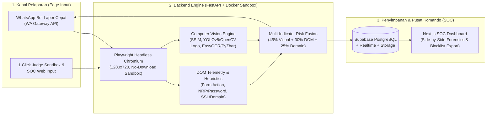

# 🛡️ VisiKartika Shield (`Zero-Day-Phising-Shield`)

**Zero-Day Visual Phishing & Military Portal Impersonation Defense System**  
*Kartika Cyber Hackathon 2026 — Kategori: **Penangkalan** (PUSSIBERAD TNI AD)*

[](#1-deskripsi-produk--skenario-taktis-tni-ad)
[](#5-panduan-menjalankan-phase-1-backend-engine)
[](#2-arsitektur--spesifikasi-tech-stack)
[](#6-skema-database-supabase-postgresql--realtime)

---

## 1. Deskripsi Produk & Skenario Taktis TNI AD

**VisiKartika Shield** adalah platform pertahanan siber *multi-modal* yang dirancang khusus untuk menangkal serangan *zero-day phishing*, kloning visual portal resmi `.mil.id`, penipuan berbasis QR Code (*Quishing*), serta mendeteksi eksfiltrasi kredensial prajurit ke server *Command & Control* (C2) eksternal.

### Masalah Nyata di Satuan
Penyerang membuat situs tiruan yang secara visual identik dengan portal resmi TNI AD (seperti **Portal Seleksi Bintara/Tamtama Siber**, halaman **Single Sign-On (SSO)** internal, atau sistem **Sisfopers / E-Militer**), lalu menyebarkan tautan maupun poster ber-QR Code melalui pesan berantai WhatsApp atau SMS kepada prajurit dan keluarganya. Pendekatan *blacklist* tradisional gagal mendeteksi situs-situs ini pada jam-jam pertama (*zero-day*) karena domain baru didaftarkan dan struktur HTML/JS-nya diacak (*obfuscated*).

### Solusi Taktis VisiKartika Shield
Sistem bekerja melalui dua kanal terpadu: **WhatsApp Bot Lapor Cepat** (untuk prajurit di lapangan) dan **Dashboard SOC Komando** (untuk operator PUSSIBERAD). Saat tautan atau tangkapan layar dikirimkan:
1. Sistem membuka URL di dalam **Headless Chromium Sandbox** terisolasi (memblokir *drive-by download* `.apk`/`.exe`).
2. Mengekstrak pohon struktur **DOM/HTML**, koordinat *bounding box* elemen `<form>` dan `<input>` sensitif (NRP, NIK, Kata Sandi, PIN, OTP), serta merekam lalu lintas jaringan lintas-domain (*cross-origin exfiltration*).
3. Membandingkan kemiripan visual halaman (**SSIM / ViT Embedding**) dan mendeteksi pencatutan lambang resmi (**Kartika Eka Paksi**, **PUSSIBERAD**, lambang **Kodam/Satuan**) menggunakan **Computer Vision (YOLOv8 / OpenCV)**.
4. Mengirimkan putusan ancaman (*verdict*) beserta bukti visual ber-anotasi *bounding box* merah/oranye ke prajurit dan layar pusat komando secara *real-time* dalam waktu **< 5 detik**.

---

## 2. Arsitektur & Spesifikasi Tech Stack



| Lapisan Sistem | Teknologi yang Digunakan | Fungsi Spesifik dalam Pipeline |
| :--- | :--- | :--- |
| **1. Kanal Pelaporan Prajurit (Edge Input)** | **WhatsApp Gateway API** (Baileys / WWebJS / Fonnte) & **Chrome Extension (Manifest V3)** | Menerima *forward* tautan mencurigakan, poster pengumuman, atau tangkapan layar langsung dari ponsel prajurit tanpa instalasi aplikasi tambahan. |
| **2. Sandbox & Ekstraksi Aman** | **Playwright** (Headless Chromium dalam **Docker Container** non-root `pwuser`) | Mengunjungi URL target di lingkungan terisolasi (`1280x720`, `accept_downloads=False`), menangkap *screenshot*, mengekstrak koordinat DOM, dan melacak *redirect chain* / domain eksternal. |
| **3. Mesin Deteksi Visual (Computer Vision)** | **PyTorch**, **OpenCV**, **YOLOv8 / ViT / CLIP**, **Scikit-Image (SSIM)**, **EasyOCR & PyZbar** | • **Deteksi Logo & Identitas:** Mengenali pencatutan lambang Kartika Eka Paksi & PUSSIBERAD beserta *bounding box*.<br>• **Visual Layout Similarity:** Menghitung kemiripan tata letak terhadap *database* tampilan resmi `.mil.id`.<br>• **OCR & Quishing Scanner:** Membaca teks dan QR code berbahaya pada poster rekrutmen palsu. |
| **4. Analisis DOM & Telemetri Domain** | **DOM Heuristic Extractor**, **URL/Host Telemetry**, **TLS/SSL & Whitelist `.mil.id`** | • **DOM Telemetry:** Mendeteksi `<form action="...">` lintas-origin, input NRP/NIK/Password, *form-less AJAX harvesting*, dan anti-inspeksi (`oncontextmenu`).<br>• **Heuristik Domain:** Mendeteksi *typosquatting* kata kunci militer di luar namespace resmi `.mil.id` / `.go.id`. |
| **5. Backend API & Database** | **FastAPI (Python)** + **Supabase (PostgreSQL, Realtime & Storage)** | Menjalankan orkestrasi sandbox & *inference* Computer Vision serta menyinkronkan log insiden secara *real-time* ke layar pusat komando. |
| **6. Command Center Dashboard (SOC)** | **Next.js (App Router)**, **TailwindCSS**, **Shadcn UI**, **Leaflet / Mapbox** | Antarmuka operator PUSSIBERAD untuk memantau insiden *real-time*, *Side-by-Side Visual Forensics*, *1-Click Judge Sandbox*, dan *Export DNS Sinkhole / Firewall Blocklist*. |

---

## 3. Rumus Skor Risiko Multi-Indikator & Logika Deteksi

VisiKartika Shield menggabungkan tiga matriks utama ke dalam **Total Risk Score (0–100)**:

$$\text{Total Risk Score} = (0.45 \times \text{Visual Similarity Score}) + (0.30 \times \text{DOM Anomaly Score}) + (0.25 \times \text{Domain Telemetry Score})$$

### Aturan Silang *Identity-Domain Mismatch*
Untuk mengatasi kelemahan *full-page similarity* ketika penyerang memodifikasi tata letak halaman, sistem menerapkan aturan silang:
- **Logo / Atribut Resmi TNI AD Terdeteksi** (`Confidence >= 80%` atau pencatutan kata kunci militer)
- **Domain Bukan Whitelist Resmi** (`domain` $\notin$ `{tniad.mil.id, rekrutmen-tni.mil.id, pussiberad.mil.id, kemhan.go.id}`)
- **Terdapat Input Kredensial Sensitif** (`NRP / NIK / Password / PIN / OTP` atau eksfiltrasi `<form>` lintas-domain)

Jika ketiga kondisi di atas terpenuhi secara bersamaan, sistem otomatis menetapkan putusan **`CRITICAL_PHISHING`** (`Total Risk Score >= 70`).

| Rentang Skor | Putusan (*Verdict*) | Tindakan Otomatis Sistem |
| :---: | :---: | :--- |
| **`70.0 – 100.0`** | `CRITICAL_PHISHING` | Peringatan merah di WhatsApp & SOC Dashboard + Rekomendasi blokir otomatis (DNS Sinkhole / Firewall Rule). |
| **`40.0 – 69.9`** | `SUSPICIOUS` | Peringatan kuning (anomali parsial ditemukan) + Antrean peninjauan analis SOC. |
| **`0.0 – 39.9`** | `SAFE` | Domain terverifikasi resmi `.mil.id` / `.go.id` atau tidak ditemukan indikasi penyamaran & pencurian kredensial. |

---

## 4. Struktur Repositori (`backend-engine` & Monorepo)

```text
Zero-Day-Phising-Shield/
├── app/
│   ├── __init__.py
│   ├── main.py                     # FastAPI Server (/api/v1/scan/phase1, /health, Static Mounts)
│   ├── models.py                   # Kontrak Data JSON Pydantic v2 (Phase1ScanResponse, dll.)
│   ├── sandbox/
│   │   ├── __init__.py
│   │   ├── browser.py              # HeadlessSandboxScanner (Playwright 1280x720 + DOM/BBox Extractor)
│   │   └── annotator.py            # OpenCV Bounding Box Visualizer (FORM EXFIL & INPUT Kredensial)
│   ├── vision/                     # (Phase 2 & 4) SSIM Similarity, Logo Detector & EasyOCR/PyZbar
│   └── reference_db/               # Template Screenshot & Logo Resmi (.mil.id)
├── mock_targets/
│   └── rekrutmen_bintara_phish.html # Target Uji Simulasi Portal Seleksi Bintara Siber TNI AD 2026
├── storage/
│   ├── screenshots/                # Tangkapan layar mentah (1280x720 PNG)
│   │   └── test_001.png
│   └── annotated/                  # Tangkapan layar dengan anotasi Bounding Box (1280x720 PNG)
│       └── test_001_dom.png
├── requirements.txt
├── Dockerfile                      # Container terisolasi (mcr.microsoft.com/playwright/python:v1.47.0-noble)
├── .dockerignore
├── test_phase1_e2e.py              # Skrip verifikasi otomatis End-to-End Phase 1
└── README.md
```

---

## 5. Panduan Menjalankan Phase 1 (Backend Engine)

**Phase 1 (Headless Sandbox Capture, DOM Form/Input Telemetry Extraction, OpenCV Bounding Box Annotation, dan FastAPI Endpoint)** telah selesai diimplementasikan dan terverifikasi penuh.

### A. Persiapan Lingkungan Lokal (Windows PowerShell / Linux / macOS)

```powershell
# 1. Buat dan aktifkan virtual environment
python -m venv .venv
.\.venv\Scripts\Activate.ps1

# 2. Instal dependensi Python dan browser Chromium Playwright
pip install --only-binary=:all: -r requirements.txt
playwright install chromium
```

### B. Menjalankan Pengujian Otomatis End-to-End (`test_phase1_e2e.py`)

```powershell
.\.venv\Scripts\python.exe test_phase1_e2e.py
```

Skrip ini akan:
1. Menjalankan server HTTP lokal untuk menyajikan `mock_targets/rekrutmen_bintara_phish.html`.
2. Memindai halaman menggunakan `HeadlessSandboxScanner` (`1280x720`, memblokir unduhan berbahaya).
3. Menghasilkan gambar mentah di `storage/screenshots/test_001.png` dan gambar beranotasi *bounding box* di `storage/annotated/test_001_dom.png`.
4. Memverifikasi bahwa `has_credential_harvesting == True`, `dom_anomaly_score == 100.0`, serta menguji endpoint FastAPI `/health` dan `POST /api/v1/scan/phase1`.

### C. Menjalankan Server FastAPI & Uji Coba 1-Click via Swagger UI

```powershell
.\.venv\Scripts\uvicorn.exe app.main:app --host 0.0.0.0 --port 8000 --reload
```

1. Buka Swagger UI di **`http://localhost:8000/docs`**.
2. Pilih endpoint **`POST /api/v1/scan/phase1`** $\rightarrow$ **Try it out**, lalu masukkan payload berikut:
   ```json
   {
     "url": "http://localhost:8000/mock-targets/rekrutmen_bintara_phish.html",
     "scan_id": "demo_001"
   }
   ```
3. Lihat hasil visual secara langsung di browser:
   - **Raw Capture (`1280x720`)**: `http://localhost:8000/static/screenshots/demo_001.png`
   - **Annotated DOM Capture (`1280x720`)**: `http://localhost:8000/static/annotated/demo_001_dom.png`

### D. Menjalankan dengan Docker

```bash
docker build -t visikartika-backend:phase1 .
docker run --rm -p 8000:8000 visikartika-backend:phase1
```

---

## 6. Skema Database Supabase (PostgreSQL + Realtime)

Jalankan *query* SQL berikut pada **Supabase SQL Editor** untuk mengaktifkan penyimpanan insiden dan pembaruan *real-time* ke Dashboard SOC:

```sql
-- 1. Tabel Referensi Portal Resmi TNI AD (Protected Brands)
CREATE TABLE official_portals (
    id UUID PRIMARY KEY DEFAULT gen_random_uuid(),
    portal_name VARCHAR(150) NOT NULL,          -- Contoh: "Portal Rekrutmen Bintara TNI AD"
    official_domain VARCHAR(255) NOT NULL,      -- Contoh: "ad.rekrutmen-tni.mil.id"
    reference_screenshot_url TEXT NOT NULL,
    dom_signature JSONB,                        -- Ringkasan struktur tag HTML resmi
    created_at TIMESTAMPTZ DEFAULT NOW()
);

-- 2. Tabel Log Pemindaian & Insiden Phishing (Realtime SOC)
CREATE TABLE scan_incidents (
    id UUID PRIMARY KEY DEFAULT gen_random_uuid(),
    submitted_url TEXT,
    reporter_source VARCHAR(50) DEFAULT 'WEB_SANDBOX', -- 'WHATSAPP_BOT', 'WEB_SANDBOX', 'BROWSER_EXT'
    reporter_unit VARCHAR(100) DEFAULT 'Simulasi Juri / Satuan Jajaran',

    -- Skor Komposit & Sub-Indikator (0 - 100)
    total_risk_score NUMERIC(5,2) NOT NULL,
    visual_similarity_score NUMERIC(5,2) NOT NULL,
    dom_anomaly_score NUMERIC(5,2) NOT NULL,
    domain_telemetry_score NUMERIC(5,2) NOT NULL,

    -- Hasil Deteksi & Bukti Forensik
    verdict VARCHAR(30) NOT NULL,               -- 'SAFE', 'SUSPICIOUS', 'CRITICAL_PHISHING'
    impersonated_target VARCHAR(150),           -- Nama portal resmi yang ditiru
    captured_screenshot_url TEXT,               -- URL screenshot dari Playwright
    annotated_bbox_url TEXT,                    -- Screenshot dengan Bounding Box merah/oranye
    detected_logos JSONB,                       -- Koordinat & confidence score logo TNI AD yang dicatut
    dom_findings JSONB,                         -- Detail tujuan eksfiltrasi form & indikator DOM

    created_at TIMESTAMPTZ DEFAULT NOW()
);

-- Aktifkan Realtime untuk tabel scan_incidents
ALTER PUBLICATION supabase_realtime ADD TABLE scan_incidents;
```

---

## 7. Timeline Eksekusi & Pembagian Tugas Tim (31 Okt – 15 Nov 2026)

Berdasarkan **Sprint Gantt & Timeline Tracker** (**21 Workstreams** & **7 Sync Milestones**, tenggat akhir pengumpulan karya: **15 November 2026 pukul 23:59 WIB**):

- **Person A (`Zuan`)**: *AI, Headless Sandbox & Computer Vision Engine (`backend-engine`)*
- **Person B (`Denin`)**: *SOC Command Platform, Supabase & WhatsApp Gateway Integrations (`frontend-soc`)*
- **Sync (`Zuan + Denin`)**: *Milestone Gateways & End-to-End Integration Verification*

| Fase | Tanggal | Assignee | Workstream / Fokus Pengerjaan | Deliverable Utama | Status |
| :---: | :---: | :---: | :--- | :--- | :---: |
| **Phase 1** | 31 Okt – 02 Nov | **Zuan** | Setup Playwright headless capture, simpan screenshot, dan ekstrak tag DOM form/input beserta *bounding box* OpenCV. | Playwright capture script, DOM extractor & OpenCV annotator (`/api/v1/scan/phase1`) | ✅ **Done** |
| **Phase 1** | 31 Okt – 02 Nov | **Denin** | Inisialisasi monorepo, setup database Supabase SQL, dan integrasi WhatsApp Gateway API. | Supabase DB schema & WA Gateway setup | ✅ **Done** |
| **Phase 1** | 31 Okt – 02 Nov | **Sync ★** | Uji konektivitas dasar: Webhook WA menerima pesan teks dan mengirim respon balik statis `"Pong"`. | Verified WA echo/Pong webhook integration | ✅ **Done** |
| **Phase 2** | 02 Nov – 04 Nov | **Zuan** | Bangun fungsi SSIM *visual similarity*, load template logo Kartika Eka Paksi, dan fungsi *auto-draw bounding box* merah pada logo. | SSIM similarity engine & logo bounding box detector | ⏳ Planned |
| **Phase 2** | 02 Nov – 04 Nov | **Denin** | Bangun router triage pesan (URL vs Gambar), domain whitelist `.mil.id`, dan formula kalkulasi skor gabungan. | Triage router, `.mil.id` whitelist & score fusion engine | ⏳ Planned |
| **Phase 2** | 02 Nov – 04 Nov | **Sync ★** | Uji kirim URL palsu via Postman ke FastAPI Person A; pastikan return JSON skor kemiripan dan screenshot ber-*bounding box*. | Postman test suite & JSON score validation | ⏳ Planned |
| **Phase 3** | 05 Nov | **Zuan** | Evaluasi akurasi deteksi dan latensi capture Playwright (< 5 detik). | Accuracy benchmarking & latency audit report | ⏳ Planned |
| **Phase 3** | 05 Nov | **Denin** | Rapikan layout Dashboard Next.js untuk monitoring insiden *real-time*. | Refined Next.js SOC incident monitoring UI | ⏳ Planned |
| **Phase 3** | 05 Nov | **Sync ★** | Ikuti **Webinar Pembekalan 2 Panitia Bersama**: sesuaikan fitur dengan arahan/kisi-kisi juri. | Briefing #2 alignment with jury criteria | ⏳ Planned |
| **Phase 4** | 06 Nov – 08 Nov | **Zuan** | Tambahkan `PyZbar` & `EasyOCR` untuk scan QR code / poster phishing pada endpoint `/api/v1/scan-image`. | PyZbar & EasyOCR scanner (`/api/v1/scan-image`) | ⏳ Planned |
| **Phase 4** | 06 Nov – 08 Nov | **Denin** | Sambungkan endpoint FastAPI Person A ke webhook WhatsApp dan masukkan 5 halaman *mock phishing* legal ke `/public/mock-targets/`. | FastAPI-WA hook & 5 legal mock phishing targets | ⏳ Planned |
| **Phase 4** | 06 Nov – 08 Nov | **Sync ★** | Tes alur penuh: Kirim screenshot poster phishing ber-QR ke nomor WhatsApp $\rightarrow$ Bot membalas analisis lengkap dalam < 5 detik. | End-to-end QR phishing scan in < 5s response | ⏳ Planned |
| **Phase 5** | 09 Nov – 11 Nov | **Zuan** | Optimasi resource container Docker (PyTorch CPU/GPU minimal footprint), pastikan dependensi Chromium terisolasi. | Docker PyTorch CPU/GPU minimal container image | ⏳ Planned |
| **Phase 5** | 09 Nov – 11 Nov | **Denin** | Buat halaman *Forensics Detail* (*Side-by-side comparison*), tombol *"1-Click Judge Test"*, dan tombol *Export DNS Sinkhole*. | Forensics side-by-side UI & 1-Click test button | ⏳ Planned |
| **Phase 5** | 09 Nov – 11 Nov | **Sync ★** | Deploy `backend-engine` ke VPS/Railway dan deploy `frontend-soc` ke Vercel; uji *public link*. | VPS backend & Vercel SOC production deployment | ⏳ Planned |
| **Phase 6** | 12 Nov – 13 Nov | **Zuan** | Tulis draft dokumen `PRE_EXISTING_DECLARATION.md` dan susun bagian arsitektur teknis pada slide presentasi. | `PRE_EXISTING_DECLARATION.md` & tech slide draft | ⏳ Planned |
| **Phase 6** | 12 Nov – 13 Nov | **Denin** | Susun slide relevansi taktis militer, rekam skenario interaksi *live* (WhatsApp $\rightarrow$ Dashboard), dan siapkan thumbnail `1200x630 px`. | Tactical slide, live video demo & cover thumbnail | ⏳ Planned |
| **Phase 6** | 12 Nov – 13 Nov | **Sync ★** | Review slide bersama: pastikan deklarasi karya *pre-existing* transparan dan sesuai format Bab G panduan hackathon. | Joint slide review & Bab G compliance check | ⏳ Planned |
| **Phase 7** | 14 Nov – 15 Nov | **Zuan** | Verifikasi stabilitas sandbox saat diuji secara konkuren oleh *multiple user*; *final freeze* kode backend. | Sandbox concurrency load test & code freeze | ⏳ Planned |
| **Phase 7** | 14 Nov – 15 Nov | **Denin** | Edit dan finalisasi video demo YouTube (< 10 menit), ambil 5 screenshot resolusi tinggi, lengkapi *link* publik. | YouTube demo video (< 10m), 5 HD screenshots | ⏳ Planned |
| **Phase 7** | 14 Nov – 15 Nov | **Sync ★** | Submit final formulir lomba sebelum **15 November 2026 pukul 23:59 WIB**. | Final official submission dossier (< 23:59 WIB) | ⏳ Planned |

---

## 8. Kepatuhan Etika, Keamanan & Deklarasi Pre-Existing (Bab G & N)

1. **Keamanan Lingkungan Demo (Zero Active Malware)**:
   Seluruh target uji *phishing* (`rekrutmen_bintara_phish.html`, SSO tiruan, dan poster QR *Quishing*) merupakan halaman statis simulasi internal yang di-*host* secara lokal di dalam lingkungan demo. Sistem tidak mengeksekusi *malware* aktif dan tidak menyerang infrastruktur pihak ketiga mana pun.
2. **Transparansi Komponen Open-Source & Pre-Existing**:
   Sesuai Bab G buku panduan hackathon, seluruh pustaka *open-source* (`FastAPI`, `Playwright`, `OpenCV`, `PyTorch`, `YOLOv8`, `CLIP/DINOv2`, `EasyOCR`, `PyZbar`, `Next.js`, `Supabase`) serta referensi riset akademis (*Phishpedia / PhishIntention / VisualPhishNet / PhiUSIIL*) dideklarasikan secara terbuka pada dokumen `docs/PRE_EXISTING_DECLARATION.md`.

---

## 9. Daftar Kelengkapan Submission (Tenggat: 15 November 2026, 23:59 WIB)

- [ ] **Link Proyek Publik**: Frontend SOC (Vercel) & Backend Sandbox Engine (Railway / VPS Docker) untuk penjurian online (**16 November 2026**).
- [ ] **Thumbnail Karya**: `1200×630 px` (JPG/PNG/WebP, maks `500 KB`).
- [ ] **5 Screenshot Resolusi Tinggi**:
  1. Dashboard SOC Komando (peta ancaman & statistik *real-time*).
  2. *Side-by-Side Visual Forensics* (*bounding box* logo/form & skor kemiripan).
  3. Analisis *DOM Telemetry* & rincian eksfiltrasi formulir kredensial.
  4. Simulasi **WhatsApp Bot Lapor Cepat** oleh prajurit.
  5. Halaman *Automated Mitigation* (*DNS Sinkhole / Firewall Blocklist Generator*).
- [ ] **Video Demonstrasi YouTube**: Durasi maksimal 10 menit.
- [ ] **Slide Penjelasan & Dokumentasi**: Arsitektur, skenario taktis TNI AD, dan deklarasi *pre-existing*.
