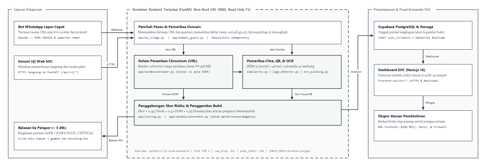

# VisiKartika Shield: Deteksi Phishing Portal Militer dan Poster Quishing Melalui Sandbox Terisolasi

**Kompetisi:** Kartika Cyber Hackathon 2026 - PUSSIBERAD TNI AD  
**Kategori:** Penangkalan (Defensive Cybersecurity)  
**Tim Pengembang:** Zuan (Backend Sandbox, Computer Vision, Container Isolation) & Denin (SOC Dashboard, WhatsApp Gateway)  
**Konsol Uji Publik:** https://zero-day-phising-shield.vercel.app/sandbox  
**Repositori Kode:** https://github.com/DenShubi/Zero-Day-Phising-Shield  

---

## Ringkasan

Kami membangun VisiKartika Shield untuk menangani masalah praktis yang sering dihadapi personel TNI AD dan calon peserta seleksi prajurit: tautan tiruan portal `.mil.id` serta poster rekrutmen palsu menyebar cepat di grup WhatsApp jauh sebelum domainnya tercatat pada daftar blokir (*blacklist*) mana pun. Di lapangan, prajurit membutuhkan cara verifikasi yang langsung bisa dipakai dari telepon genggam tanpa memasang aplikasi baru, sementara operator siber membutuhkan bukti visual dan aturan pemblokiran yang siap diterapkan.

Melalui VisiKartika Shield, prajurit cukup meneruskan pesan mencurigakan atau foto poster ke bot WhatsApp Lapor Cepat, atau analis memasukkan alamat situs pada konsol web SOC. Sistem membuka tautan di dalam peramban Chromium tanpa antarmuka (*headless*) yang terisolasi, membandingkan tata letak halaman terhadap 37 beranda resmi `.mil.id` dan `.go.id`, memeriksa pencatutan 41 lambang instansi pertahanan, menelusuri tujuan pengiriman formulir di pohon DOM, serta membaca kode QR dan teks pada gambar poster.

Pada pengujian terhadap 95 sampel uji (12 halaman web simulasi, 24 poster pengumuman baik resmi maupun penipuan, 22 tangkapan layar situs umum non-militer, dan 37 beranda portal resmi), seluruh 20 sampel berbahaya dan 75 sampel aman terklasifikasi dengan tepat tanpa *false positive* maupun *false negative*. Waktu pemindaian median tercatat 1,510 detik untuk tautan web dan 1,592 detik untuk berkas gambar di atas prosesor standar tanpa GPU.

---

## 1. Masalah Lapangan dan Keterbatasan Daftar Blokir

Rekayasa sosial yang mencatut identitas TNI AD umumnya muncul dalam tiga pola. Pola pertama adalah situs tiruan yang meniru halaman masuk seleksi prajurit (`ad.rekrutmen-tni.mil.id`) atau layanan internal seperti Sisfopers di atas domain murah baru (`.com`, `.xyz`, `.top`, atau domain *tunnel* sementara) guna memanen NRP, NIK, kata sandi, dan kode OTP. Pola kedua berupa poster bergambar lambang Kartika Eka Paksi atau Panpus Penerimaan Prajurit yang menawarkan kelulusan jalur khusus dengan syarat transfer biaya administrasi ke rekening pribadi, atau menyuruh korban memasang berkas aplikasi `.apk` di luar toko resmi. Pola ketiga menyembunyikan alamat situs palsu di dalam gambar kode QR (*Quishing*) pada surat edaran tiruan agar tidak terbaca oleh penyaring tautan teks biasa di aplikasi pesan.

Pendekatan pertahanan yang hanya mengandalkan reputasi domain atau pencocokan tanda tangan HTML sering terlambat merespons ketiga pola tersebut. Domain yang baru didaftarkan beberapa menit sebelumnya belum memiliki riwayat buruk di basis data intelijen ancaman, sedangkan kode sumber halaman mudah diacak ulang oleh pembuatnya. Namun ada satu hal yang tidak bisa disembunyikan penyerang jika ingin mengelabui korban: halaman atau poster tersebut tetap harus menampilkan atribut visual resmi TNI AD dan menyediakan kolom pengisian data atau petunjuk kontak kepada target. Celahan inilah yang kami gunakan sebagai dasar deteksi.

---

## 2. Arsitektur Sistem dan Alur Pemindaian

Sistem dibagi menjadi tiga bagian yang berjalan terpisah: saluran pelaporan di sisi pengguna, mesin analisis terisolasi berbasis FastAPI di dalam kontainer Docker, serta pusat pemantauan SOC berbasis Next.js dan Supabase.

Ketika laporan masuk dari webhook OpenWA (`app/webhook_openwa.py`), sistem lebih dulu memverifikasi tanda tangan HMAC-SHA256, menyamarkan nomor telepon pengirim untuk pencatatan log, dan memeriksa kunci *idempotency* agar pesan yang terkirim ganda tidak diproses berulang. Modul `app/wa_triage.py` kemudian memilah apakah kiriman berisi tautan URL atau lampiran gambar.

Permintaan yang berisi URL diarahkan ke endpoint `POST /api/v1/scan-url`, tempat peramban Chromium merender halaman pada ukuran `1280x720` piksel untuk mengambil tangkapan layar sekaligus mengekstrak struktur DOM. Permintaan berupa foto poster atau tangkapan layar ponsel langsung diproses oleh `POST /api/v1/scan-image` tanpa perlu membuka peramban. Hasil pemeriksaan dari kedua jalur tersebut diberi kotak penanda (*bounding box*) pada titik temuan oleh `app/sandbox/annotator.py`, diunggah secara asinkron ke Supabase Storage, dan dicatat ke tabel PostgreSQL `scan_incidents`. Begitu baris baru tersimpan, kanal WebSocket `supabase_realtime` memperbarui layar Dashboard SOC seketika, sementara bot WhatsApp mengirimkan ringkasan putusan beserta gambar bukti kembali ke pelapor.

Antarmuka web SOC yang dibangun pada folder `frontend-soc/` berkomunikasi langsung melalui HTTPS ke layanan FastAPI tanpa melewati *serverless route proxy* tambahan agar tidak terpotong batas waktu tunggu (*timeout*) saat memindai situs yang lambat merespons.

---

## 3. Isolasi Sandbox Chromium dan Kontainer Docker

Membuka tautan asing secara otomatis membawa risiko tersendiri bagi server pemindai. Halaman jahat dapat mencoba mengunduh berkas paksa, membuka kotak dialog tanpa henti untuk mengunci proses, menguras memori lewat skrip berat, atau membelokkan permintaan jaringan (*sub-request*) ke alamat internal server (*Server-Side Request Forgery* / SSRF). Tabel berikut merangkum pengamanan berlapis yang kami terapkan pada `app/sandbox/browser.py` dan konfigurasi Docker.

| Area Pengamanan | Implementasi pada Kode dan Kontainer | Risiko yang Dicegah |
| :--- | :--- | :--- |
| Pencegahan SSRF pada sub-request | Pencegat `page.route("**/*")` memanggil `is_subrequest_allowed()` untuk membatalkan akses ke skema `file://`, `chrome://`, IP metadata cloud `169.254.169.254`, `127.0.0.1`, serta jaringan privat RFC1918 (`10/8`, `172.16/12`, `192.168/16`). | Pencurian kredensial server atau pemindaian port layanan internal lewat *iframe* dan *redirect* tersembunyi. |
| Konteks peramban sekali pakai | Setiap pemindaian membuat `BrowserContext` baru dengan `accept_downloads=False`, `service_workers="block"`, `permissions=[]`, serta penutup otomatis untuk `alert()`, `confirm()`, `window.print()`, dan `window.open()`. | Unduhan otomatis berkas `.apk`/`.exe` (*drive-by download*) dan macetnya antrean akibat jebakan *popup*. |
| Batas memori dan daur ulang proses | Argumen V8 `--max-old-space-size=256`, `--renderer-process-limit=2`, variabel `MALLOC_ARENA_MAX=2`, batas konkurensi `Semaphore(4)`, dan pembuatan ulang proses Chromium otomatis setiap 60 pemindaian. | Kebocoran memori jangka panjang maupun lonjakan RAM akibat skrip sisi klien yang sengaja dibuat berat. |
| Pembatasan hak kontainer | Multi-stage `Dockerfile` di atas `python:3.12-slim-bookworm` dengan init `tini` (PID 1), akun non-root `pwuser` (`UID 10001`), sistem berkas `read_only: true`, `cap_drop: ALL`, `no-new-privileges:true`, dan `pids_limit: 256`. | Pengambilalihan kontainer, penumpukan *zombie process* Chromium, dan pembengkakan ukuran *image*. |

Pada sisi pengemasan kontainer, kami hanya memasang biner Chromium beserta pustaka sistem yang benar-benar dipakainya tanpa menyertakan Firefox maupun WebKit sehingga ukuran unduhan peramban berkurang lebih dari 1 GB. Berkas `.dockerignore` juga membatasi konteks *build* menjadi 154 berkas (31,36 MB). Selain itu, argumen `TORCH_PROFILE` pada `Dockerfile` menyediakan tiga pilihan kompilasi sesuai kapasitas server: `none` untuk penerapan ringan berbasis Tesseract OCR dan OpenCV tanpa PyTorch, `cpu` untuk memasang paket *wheel* PyTorch khusus CPU beserta EasyOCR tanpa beban pustaka CUDA (~2,3 GB), serta `gpu` untuk server pusat komando yang memiliki kartu grafis NVIDIA.

---

## 4. Metode Deteksi Visual, DOM, dan Poster Quishing

### 4.1 Pencocokan Tata Letak Portal Resmi (`app/vision/similarity.py`)
Agar pembandingan tampilan halaman penuh tidak membebani CPU pada setiap permintaan, ke-37 tangkapan layar beranda portal resmi (`.mil.id`, `.go.id`, dan `.ac.id` pertahanan) diubah ukurannya ke matriks `320x180` bertipe `float32` satu kali ketika aplikasi dijalankan. Nilai rata-rata lokal, varians Gaussian, dan citra terpusat dari seluruh referensi disimpan di RAM. Ketika gambar halaman target masuk, perhitungan *Structural Similarity Index* (SSIM) terhadap 37 portal referensi selesai dalam waktu rata-rata 46,3 ms pada jalur gambar dan 104,3 ms pada jalur URL.

### 4.2 Deteksi Pencatutan 41 Lambang Instansi (`app/vision/logo_detector.py`)
Pelaku *phishing* sering mengganti warna latar atau menggeser posisi kolom supaya skor kemiripan halaman penuh turun, tetapi tetap menempelkan lambang satuan di bagian kepala halaman. Kami menyiapkan basis referensi 41 lambang ber-kanal transparansi alfa yang mencakup Mabes TNI, Kartika Eka Paksi TNI AD, Panpus Penerimaan Prajurit, PUSSIBERAD, 15 Kodam, Kostrad, Kopassus, Kemhan RI, Akmil, Unhan, BSSN, BNPT, Lemhannas, Basarnas, dan Bakamla.

Pencarian template multi-skala langsung pada resolusi penuh untuk 41 lambang akan memakan waktu terlalu lama. Untuk menyiasatinya, `logo_detector.py` menyaring kandidat dalam dua tahap. Tahap pertama memperkecil kanvas ke skala `0.35x` dan menguji 10 ukuran geometris secara kasar untuk memilih kandidat lambang dengan korelasi tertinggi. Tahap kedua menguji ulang kandidat teratas tersebut pada resolusi asli dengan menyesuaikan warna latar lokal di sekitar titik kandidat dan menghitung korelasi ber-masker alfa (`cv2.TM_CCOEFF_NORMED`, ambang `>= 0,80`). Pendekatan ini menghasilkan posisi kotak lambang yang presisi dalam waktu sekitar 1,06 hingga 1,25 detik.

### 4.3 Inspeksi Pohon DOM dan Tujuan Pengiriman Formulir (`app/sandbox/browser.py`)
Saat halaman dirender di Chromium, skrip ekstraksi memeriksa atribut setiap elemen `<form>` dan `<input>` yang tampak di layar. Sistem menandai bahaya tinggi apabila atribut `action` pada formulir mengarah ke luar domain halaman atau ke layanan yang lazim dipakai menampung data curian seperti `api.telegram.org`, webhook Discord, `webhook.site`, Google Apps Script, maupun domain *tunnel* (`ngrok`, `trycloudflare`). Karena banyak kit *phishing* modern tidak lagi memakai tag `<form>` melainkan mengirim nilai input langsung lewat `fetch()` atau `XMLHttpRequest`, pemeriksa kami juga mendeteksi keberadaan kolom sensitif (`NRP`, `NIK`, `Sisfopers`, `Password`, `PIN`, `OTP`) yang berdiri sendiri serta skrip pemblokir klik kanan (`oncontextmenu="return false"`).

### 4.4 Pembacaan Kode QR, Teks Poster, dan Perbaikan Salah Baca OCR (`app/vision/image_analyzer.py`)
Untuk berkas gambar yang dikirim ke `/api/v1/scan-image`, modul analisis lebih dulu mengenali bentuk kanvasnya (`POSTER_FLYER`, `MOBILE_SCREENSHOT`, atau `WEB_SCREENSHOT`) dan mencari kontur persegi panjang menyerupai kolom input formulir menggunakan OpenCV. Pembacaan kode QR di dalam `app/vision/ocr_quishing.py` dijalankan berlapis: citra diuji menggunakan `cv2.QRCodeDetector` pada empat variasi prapemrosesan (warna asli, *grayscale*, ambang biner *Otsu*, serta perbesaran dua kali lipat untuk menangkap QR kecil di pojok poster), lalu diperkuat oleh dekoder `PyZbar` (`libzbar0`). Setiap alamat URL yang berhasil dikeluarkan dari kode QR langsung diperiksa oleh `app/domain_guard.py`.

Pada tahap pembacaan teks (OCR), kami menjalankan *worker* OCR yang tetap siaga di memori (`Windows.Media.Ocr` saat berjalan di Windows lokal dan `Tesseract` paket bahasa `ind+eng` di dalam kontainer Linux, disertai dukungan pemuatan *on-demand* `EasyOCR`) sehingga ekstraksi teks rata-rata selesai dalam 94 ms. Teks hasil bacaan diperiksa terhadap pola penipuan rekrutmen seperti permintaan biaya administrasi, janji kelulusan kuota khusus, pencantuman nomor WhatsApp pribadi tanpa rujukan portal resmi, dan ajakan mengunduh berkas `.apk`.

Selama pengujian terhadap poster sosialisasi asli TNI AD, kami menemukan bahwa jenis huruf tebal bergaya militer kerap membuat mesin OCR keliru membaca huruf `M` menjadi `H`, misalnya `REKRUTMEN-TNI.HIL.ID`. Tanpa koreksi, poster resmi bisa dicurigai memuat domain asing. Karena itu kami menambahkan fungsi perbaikan konteks karakter optik yang mengenali pola salah baca tersebut dan mengembalikannya ke `rekrutmen-tni.mil.id`, sembari tetap memverifikasi keberadaan keterangan resmi bahwa pendaftaran prajurit tidak dipungut biaya.

---

## 5. Perhitungan Skor Risiko dan Pencegahan False Positive

Ketiga komponen pemeriksaan digabungkan di dalam `app/scoring.py` menjadi skor risiko akhir bernilai 0 sampai 100 menggunakan bobot tetap:

$$\text{Total Risk Score} = (0,45 \times \text{Visual Score}) + (0,30 \times \text{DOM Score}) + (0,25 \times \text{Domain Score})$$

Skor `70,0 - 100,0` menghasilkan putusan `CRITICAL_PHISHING` yang memicu peringatan merah di WhatsApp dan rekomendasi aturan blokir DNS di layar SOC. Skor `40,0 - 69,9` masuk kategori `SUSPICIOUS` untuk peninjauan analis, sedangkan `0,0 - 39,9` dinyatakan `SAFE`.

Mengandalkan rata-rata tertimbang saja memiliki celah: halaman *phishing* yang hanya menempelkan logo kecil tanpa meniru seluruh tata letak halaman bisa memperoleh skor rata-rata tanggung, sementara portal resmi `.mil.id` yang sah memiliki kolom kata sandi sehingga berisiko mendapat skor anomali DOM. Untuk mengatasinya, `app/scoring.py` menerapkan lima aturan pengunci deterministik di atas rumus dasar tersebut.

| Aturan pada `app/scoring.py` | Kondisi Pemicu | Hasil Putusan |
| :--- | :--- | :--- |
| `IDENTITY_DOMAIN_MISMATCH` | Lambang resmi TNI/pertahanan terdeteksi (`>= 80%`) pada domain di luar daftar resmi `.mil.id`/`.go.id`, disertai kolom input kredensial (`NRP`, `Sandi`, `OTP`) atau pengiriman form eksternal. | Skor dikunci minimal `92,0` (`CRITICAL_PHISHING`). |
| `QUISHING_MALICIOUS_QR` | Kode QR pada poster atau halaman web mengarah ke domain tiruan berisiko tinggi atau penyingkat tautan mencurigakan. | Skor dikunci minimal `90,0` (`CRITICAL_PHISHING`). |
| `POSTER_SCAM_CALO_APK` | Poster bertema seleksi prajurit memuat narasi pungutan biaya, jaminan lulus, kontak pribadi tanpa domain resmi, atau tautan berkas `.apk`. | Skor dikunci minimal `88,0` (`CRITICAL_PHISHING`). |
| `OFFICIAL_DOMAIN_TRUST_GUARD` | Nama host terverifikasi berada di dalam himpunan `OFFICIAL_MIL_DOMAINS` atau tampilan cocok `>= 95,5%` dengan beranda resmi tanpa URL eksternal mencurigakan. | Putusan ditetapkan `SAFE` agar halaman login resmi tidak terkena penalti. |
| `GENERAL_NON_TNI_GUARD` | Halaman web atau poster milik layanan sipil umum (misalnya GitHub, portal kampus, situs berita) tanpa pencatutan lambang militer dan tanpa pola penipuan `.apk`/calo. | Putusan ditetapkan `SAFE` (`GENERAL_WEB_SAFE`). |

---

## 6. Evaluasi Akurasi dan Pengukuran Latensi

Kami menguji akurasi dan kecepatan sistem menggunakan skrip `scripts/benchmark_phase3.py` terhadap 95 sampel uji yang terdiri atas 20 sampel berbahaya (*phishing*, poster calo, *Quishing*, dan modus `.apk`) serta 75 sampel aman (beranda `.mil.id`/`.go.id`, poster penerimaan resmi gratis, dan tangkapan layar web umum). Data mentah hasil pengujian tersimpan di `storage/phase3_benchmark_results.json`.

### 6.1 Akurasi per Kelompok Sampel Uji

Seluruh 95 sampel berhasil diklasifikasikan sesuai label sebenarnya (`TP = 20`, `TN = 75`, `FP = 0`, `FN = 0`, `ROC-AUC = 1,0000`, `PR-AUC = 0,9803`). Rincian capaian untuk keempat kelompok sampel ditampilkan pada tabel berikut.

| Kelompok Sampel Uji | Jalur Uji | Jumlah | Tepat | Akurasi | Rata-Rata | Latensi P95 | Di Bawah 5 dtk |
| :--- | :--- | :---: | :---: | :---: | :---: | :---: | :---: |
| 1. Halaman HTML Sandbox (Phishing & Aman) | `scan-url` | 12 | 12 | 100,00% | 1,576 dtk | 2,232 dtk | 100% |
| 2. Poster Rekrutmen, Calo, QR, & APK | `scan-image` | 24 | 24 | 100,00% | 1,614 dtk | 1,961 dtk | 100% |
| 3. Tangkapan Layar Web Umum Non-TNI | `scan-image` | 22 | 22 | 100,00% | 1,606 dtk | 1,756 dtk | 100% |
| 4. Beranda Portal Resmi `.mil.id` & `.go.id` | `scan-image` | 37 | 37 | 100,00% | 1,638 dtk | 1,804 dtk | 100% |

### 6.2 Perbandingan terhadap Pendekatan Tunggal (Baseline)

Untuk melihat kontribusi penggabungan fitur, kami membandingkan hasil sistem penuh terhadap tiga pendekatan pembanding pada himpunan 95 sampel yang sama.

| Pendekatan Deteksi | Akurasi | Precision | Recall | Specificity | FP | FN | F1-Score |
| :--- | :---: | :---: | :---: | :---: | :---: | :---: | :---: |
| Tebakan Kelas Mayoritas (Naive Baseline) | 78,95% | 0,00% | 0,00% | 100,00% | 0 | 20 | 0,00% |
| Heuristik Domain dan Teks URL Saja | 87,37% | 70,00% | 70,00% | 92,00% | 6 | 6 | 70,00% |
| Kemiripan Tampilan SSIM Saja | 89,47% | 100,00% | 50,00% | 100,00% | 0 | 10 | 66,67% |
| VisiKartika Shield (Gabungan Visual + DOM + Domain) | 100,00% | 100,00% | 100,00% | 100,00% | 0 | 0 | 100,00% |

Pemeriksaan berbasis domain dan URL saja meleset pada 6 poster penipuan yang hanya mencantumkan nomor telepon tanpa tautan web serta menghasilkan 6 *false positive*. Sebaliknya, pencocokan SSIM halaman penuh saja memiliki *precision* sempurna tetapi melewatkan separuh sampel berbahaya (`FN = 10`, *recall* 50,00%) karena pelaku mengubah komposisi warna dan letak kolom. Penggabungan deteksi lambang, inspeksi kolom formulir, pembacaan QR/OCR, dan verifikasi domain menutup kelemahan masing-masing metode tunggal tersebut.

### 6.3 Rincian Waktu Eksekusi per Tahap dan Uji Beban Serentak

Inisialisasi awal kolam peramban (`scanner.warmup()`) membutuhkan 3.599,5 ms satu kali saat server dinyalakan. Setelah peramban siap, pemindaian berikutnya menggunakan `BrowserContext` baru di atas proses Chromium yang sudah berjalan sehingga latensi tetap rendah.

| Tahap Pemindaian URL (N = 12) | Rata-Rata | Tahap Pemindaian Gambar (N = 83) | Rata-Rata |
| :--- | :---: | :--- | :---: |
| 1. Pembuatan `BrowserContext` baru | 66,5 ms | 1. Pembacaan berkas citra | 33,2 ms |
| 2. Navigasi `goto(domcontentloaded)` | 23,0 ms | 2. Pencocokan SSIM (37 portal) | 46,3 ms |
| 3. Tunggu render stabil (`requestAnimationFrame`) | 213,5 ms | 3. Analisis geometri, kontur form, & OCR | 94,0 ms |
| 4. Tangkapan layar PNG & ekstraksi DOM | 73,1 ms | 4. Pencarian piramida 41 lambang | 1258,8 ms |
| 5. Penggambaran kotak DOM OpenCV | 20,6 ms | 5. Dekode kode QR multi-tahap | 187,7 ms |
| 6. Pencocokan SSIM (37 portal) | 104,3 ms | 6. Perhitungan skor & sinkronisasi | 2,0 ms |
| 7. Pencarian piramida 41 lambang | 1065,9 ms | Median (P50) / Maksimum Gambar | 1592 ms / 2205 ms |
| Median (P50) / Maksimum URL | 1510 ms / 2990 ms | Uji 4 Permintaan URL Serentak | Rata-rata 3025 ms (Maks 4291 ms) |

Sebagian besar waktu hitung terserap pada pencarian multi-skala ke-41 lambang instansi (~1,06 sampai 1,25 detik), sedangkan tahap lain rata-rata selesai di bawah 220 ms. Ketika diuji menerima empat permintaan pemindaian URL secara bersamaan, waktu tunggu tertinggi tercatat 4,291 detik per permintaan sehingga seluruhnya tetap berada di bawah target batas layanan 5 detik.

---

## 7. Deklarasi Komponen Pre-Existing dan Keamanan Demo (Bab G & Bab N)

Seluruh kode inti aplikasi yang terdiri atas 21 modul Python di `backend-engine/app/` beserta skrip pengujian dan 47 berkas TypeScript/React di `frontend-soc/src/` kami tulis sendiri selama masa pengerjaan lomba (31 Oktober s.d. 15 November 2026). Rincian lengkap per modul dan lisensi pustaka pihak ketiga dilampirkan secara terpisah dalam dokumen `PRE_EXISTING_DECLARATION`.

Secara garis besar, kerangka kerja dan pustaka *open-source* yang kami gunakan meliputi FastAPI, Uvicorn, Pydantic, Playwright (Chromium), OpenCV Headless, NumPy, HTTPX, PyZbar (`libzbar0`), Tesseract OCR, serta dukungan opsional PyTorch dan EasyOCR pada sisi *backend*; kemudian Next.js 16.4.4, React 19.3.0, Tailwind CSS 4, dan klien `@supabase/supabase-js` pada sisi *frontend* SOC, ditambah jembatan pesan OpenWA dan basis data terkelola Supabase. Pada tahap perancangan awal, kami sempat mempertimbangkan pemakaian model `YOLOv8` dan `CLIP/DINOv2`, namun pada implementasi akhir kami menggantinya dengan algoritma piramida *template matching* ber-masker alfa dan SSIM pra-komputasi buatan sendiri di atas OpenCV/NumPy agar sistem dapat dijalankan cepat pada server CPU biasa tanpa memerlukan GPU maupun unduhan bobot model berukuran besar.

Ke-41 berkas lambang referensi berasal dari repositori publik Wikimedia Commons dan situs resmi instansi terkait semata-mata sebagai pembanding anti-pencatutan, sedangkan ke-37 tangkapan layar referensi diambil dari halaman depan publik `.mil.id` dan `.go.id` tanpa mengakses jaringan tertutup. Gagasan pemeriksaan silang antara identitas merek visual dan nama domain merujuk pada makalah ilmiah *Phishpedia* (USENIX 2021), *PhishIntention* (USENIX 2022), *VisualPhishNet* (ACM CCS 2020), dan *PhiUSIIL* (Computers & Security 2024) tanpa menyalin kode maupun model terlatih dari keempat riset tersebut.

Sesuai ketentuan Bab N panduan kompetisi, seluruh halaman uji *phishing* di dalam folder `mock_targets/` merupakan berkas HTML statis lokal yang dibuat khusus untuk simulasi penjurian, tidak mengandung *malware* aktif, tidak mengirim kredensial ke pihak eksternal mana pun, dan seluruh pencatatan log nomor pengirim WhatsApp telah disamarkan melalui modul `app/security.py`.
