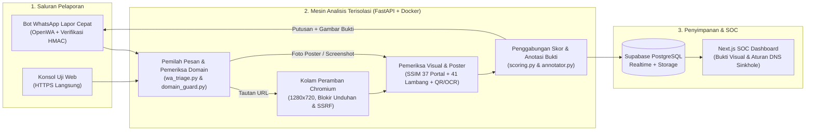

# Materi Slide Presentasi: Bagian Arsitektur Teknis (Porsi Zuan)

**Proyek:** VisiKartika Shield (`Zero-Day-Phising-Shield`)  
**Kompetisi:** Kartika Cyber Hackathon 2026 - PUSSIBERAD TNI AD (Kategori: Penangkalan)  
**Penyaji Bagian Teknis:** Zuan (Backend Sandbox, Computer Vision, Skor Risiko, Benchmark, & Kontainer Docker)  
**Alokasi Durasi:** sekitar 4,5 menit (6 slide teknis, digabung dengan slide taktis dan demo milik Denin agar total di bawah 10 menit)

---

## Pembagian Urutan Slide Tim (Zuan + Denin)

| No | Pokok Bahasan Slide | Penyaji | Estimasi |
| :---: | :--- | :---: | :---: |
| 1 | Modus Phishing Portal `.mil.id`, Poster Calo, dan Keterbatasan Daftar Blokir | Denin | ~1,0 mnt |
| 2 | Alur Operasional Prajurit: Bot WhatsApp Lapor Cepat ke Layar SOC | Denin | ~1,0 mnt |
| 3 | Arsitektur Tiga Bagian dan Alur Pemeriksaan URL maupun Gambar | Zuan | ~0,8 mnt |
| 4 | Isolasi Peramban Chromium dan Pengamanan Kontainer Docker | Zuan | ~0,8 mnt |
| 5 | Deteksi Tampilan SSIM, 41 Lambang Instansi, DOM, dan Kode QR/OCR | Zuan | ~1,0 mnt |
| 6 | Perhitungan Skor Risiko dan Aturan Anti-False-Positive | Zuan | ~0,8 mnt |
| 7 | Hasil Pengujian 95 Sampel dan Pengukuran Latensi per Tahap | Zuan | ~0,7 mnt |
| 8 | Peragaan Langsung: Lapor via WhatsApp, Bukti Visual, & Ekspor DNS Sinkhole | Denin | ~2,5 mnt |
| 9 | Transparansi Pustaka Open-Source (Bab G) dan Keamanan Demo (Bab N) | Zuan & Denin | ~0,4 mnt |

---

## Slide 3: Arsitektur Sistem dan Alur Pemeriksaan (< 5 Detik)

### Judul Slide
Pemisahan Saluran Lapor, Sandbox Analisis, dan Pusat Pemantauan SOC

### Skema Alur untuk Slide

### Poin Tampil di Slide
- Dua jalur pemeriksaan terpisah: `POST /api/v1/scan-url` merender halaman web di Chromium, sedangkan `POST /api/v1/scan-image` langsung memeriksa berkas foto poster atau tangkapan layar.
- Konsol web SOC mengirim permintaan langsung via HTTPS ke FastAPI tanpa perantara *serverless proxy* agar tidak terpotong batas *timeout*.
- Setiap hasil pemeriksaan menghasilkan gambar bukti bertanda *bounding box* pada lambang yang dicatut, kolom input pencuri data, atau kode QR palsu, lalu dikirim serentak ke WhatsApp pelapor dan layar SOC lewat WebSocket Supabase Realtime.

### Catatan Bicara (Zuan - ~45 detik)
> "Arsitektur sistem kami pisahkan menjadi tiga bagian agar server pemindai tidak tercampur dengan antarmuka pusat komando. Saat prajurit meneruskan tautan mencurigakan atau foto poster ke bot WhatsApp, modul triage langsung memilah jenis kirimannya. Bila kiriman berupa tautan web, sistem membukanya di kolam peramban Chromium beresolusi 1280x720 untuk mengambil gambar halaman dan membaca pohon DOM. Bila kiriman berupa foto poster atau tangkapan layar, sistem langsung menjalankan pemeriksaan visual, QR, dan OCR tanpa membuka peramban. Hasil akhirnya diberi kotak penanda pada titik temuan, disimpan ke Supabase, lalu tampil langsung di layar SOC sekaligus dibalas ke WhatsApp prajurit."

---

## Slide 4: Isolasi Peramban Chromium dan Kontainer Docker

### Judul Slide
Membuka Tautan Asing Tanpa Membahayakan Jaringan Internal

### Tabel Ringkas di Slide

| Lapisan Pengamanan | Implementasi (`app/sandbox/browser.py` & `Dockerfile`) | Celah yang Ditutup |
| :--- | :--- | :--- |
| Pencegat Jaringan Anti-SSRF | `page.route` memanggil `is_subrequest_allowed()` untuk memutus skema `file://`, `chrome://`, metadata cloud `169.254.169.254`, `127.0.0.1`, dan IP privat RFC1918 | Pencurian token server atau pemindaian jaringan internal lewat *redirect* tersembunyi |
| Konteks Sekali Pakai | `accept_downloads=False`, `service_workers="block"`, `permissions=[]`, penutup otomatis `alert()`, `print()`, dan `window.open()` | Unduhan paksa berkas `.apk`/`.exe` dan macetnya proses akibat jebakan kotak dialog |
| Batas Memori & Daur Ulang | Batas V8 `256 MB`, maks 2 *renderer*, `MALLOC_ARENA_MAX=2`, `Semaphore(4)`, pembuatan ulang proses Chromium tiap 60 pemindaian | Kehabisan RAM (*Out-of-Memory*) akibat halaman atau skrip berat |
| Kontainer Docker Minimal | `python:3.12-slim-bookworm` khusus Chromium (hemat >1 GB tanpa Firefox/WebKit), `tini` PID 1, akun `pwuser` (`UID 10001`), `read_only: true`, `cap_drop: ALL` | Penyalahgunaan hak akses kontainer dan kebocoran *zombie process* |

### Catatan Tambahan di Slide
- Konteks *build* Docker dijaga tetap kecil di angka 31,36 MB (154 berkas).
- Tiga profil kompilasi (`TORCH_PROFILE`): `none` (ringan tanpa PyTorch), `cpu` (*wheel* PyTorch khusus CPU, hemat ~2,3 GB beban CUDA), dan `gpu` (CUDA 12.4).

### Catatan Bicara (Zuan - ~50 detik)
> "Karena server pemindai membuka tautan asing dari lapangan, pengamanan *sandbox* menjadi prioritas kami. Setiap alamat dibuka dalam konteks Chromium baru yang menolak semua unduhan berkas `.apk` maupun `.exe`, mematikan *ServiceWorker*, membatasi memori V8 di 256 megabita, serta memutus setiap *sub-request* yang mencoba membelok ke IP privat atau metadata cloud 169.254.169.254. Di sisi kontainer, kami menyusun *multi-stage Dockerfile* berbasis Debian Slim yang hanya memasang Chromium sehingga menghemat lebih dari satu gigabita, berjalan tanpa akses *root* dengan sistem berkas *read-only*, serta mendukung tiga profil *build*: ringan tanpa PyTorch, PyTorch CPU, atau GPU."

---

## Slide 5: Pemeriksaan Visual, Struktur DOM, dan Poster Quishing

### Judul Slide
Menggabungkan Bukti Tampilan, Pohon DOM, dan Pembacaan Kode QR/OCR

### Tiga Blok Isi di Slide

1. Kemiripan Tampilan & 41 Lambang (`similarity.py` & `logo_detector.py`)
   - Statistik rata-rata dan varians Gaussian 37 beranda resmi `.mil.id`/`.go.id` (`320x180 float32`) dihitung sekali di RAM sehingga pencocokan SSIM selesai rata-rata dalam 46,3 ms.
   - Pencarian piramida dua tahap (penyaringan kasar `0.35x` diikuti pencocokan ber-masker alfa) mendeteksi pencatutan 41 lambang instansi pertahanan dan siber dalam ~1,06 - 1,25 detik.

2. Pemeriksaan Pohon DOM (`browser.py`)
   - Mengecek tujuan `<form action="...">` ke luar domain atau ke penampung curian (`api.telegram.org`, webhook Discord, `webhook.site`, domain *tunnel*).
   - Mengenali kolom input kredensial (`NRP`, `NIK`, `Sisfopers`, `Password`, `PIN`, `OTP`) yang dikirim lewat AJAX tanpa tag `<form>`, serta skrip pemblokir klik kanan.

3. Pemeriksaan Poster & Kode QR (`image_analyzer.py` & `ocr_quishing.py`)
   - Membedakan geometri `POSTER_FLYER`, `MOBILE_SCREENSHOT`, dan `WEB_SCREENSHOT` beserta kontur kotak formulir.
   - Membaca kode QR berlapis menggunakan OpenCV (4 prapemrosesan termasuk perbesaran 2x) dan `PyZbar` (`libzbar0`).
   - Mengekstrak teks dalam ~94 ms lewat *worker* OCR (`Tesseract ind+eng` / WinRT + opsi `EasyOCR`) untuk menangkap modus pungutan biaya calo dan berkas `.apk`, dilengkapi perbaikan salah baca karakter optik seperti `.HIL.ID` kembali ke `.mil.id`.

### Catatan Bicara (Zuan - ~60 detik)
> "Agar situs atau poster palsu tetap tertangkap walau baru dibuat, kami memeriksa tiga hal sekaligus. Pertama pada sisi visual, statistik SSIM untuk 37 beranda resmi disimpan di memori sehingga pencocokan tata letak selesai dalam 46 milidetik, ditambah pencarian piramida ber-masker alfa terhadap 41 lambang satuan TNI dan lembaga pertahanan. Kedua pada struktur DOM, kami melacak ke mana formulir mengirim data, termasuk halaman tanpa tag `<form>` yang memanen NRP dan kata sandi lewat `fetch`. Ketiga untuk kiriman foto poster di `scan-image`, sistem memadukan pembaca kode QR OpenCV dan PyZbar dengan OCR Bahasa Indonesia guna mendeteksi poster calo berbayar maupun sebaran berkas `.apk`, sekaligus memperbaiki salah baca huruf pada poster resmi gratis TNI AD."

---

## Slide 6: Perhitungan Skor Risiko dan Pencegahan False Positive

### Judul Slide
Pembobotan Risiko dan Lima Aturan Pengunci pada `app/scoring.py`

### Rumus dan Tabel di Slide

$$\text{Total Risk Score} = (0,45 \times \text{Visual Score}) + (0,30 \times \text{DOM Score}) + (0,25 \times \text{Domain Score})$$

| Aturan Pengunci | Kondisi Pemicu | Putusan |
| :--- | :--- | :--- |
| `IDENTITY_DOMAIN_MISMATCH` | Lambang resmi TNI/pertahanan terdeteksi (`>= 80%`) di luar domain resmi `.mil.id`/`.go.id` disertai permintaan input kredensial (`NRP`/`Sandi`/`OTP`) | Skor `>= 92,0` (`CRITICAL_PHISHING`) |
| `QUISHING_MALICIOUS_QR` | Kode QR mengarah ke domain tiruan berisiko tinggi atau penyingkat tautan mencurigakan | Skor `>= 90,0` (`CRITICAL_PHISHING`) |
| `POSTER_SCAM_CALO_APK` | Poster rekrutmen memuat pungutan biaya, janji kelulusan, nomor WA pribadi tanpa portal resmi, atau berkas `.apk` | Skor `>= 88,0` (`CRITICAL_PHISHING`) |
| `OFFICIAL_DOMAIN_TRUST_GUARD` | Nama host berada pada `OFFICIAL_MIL_DOMAINS` atau tampilan cocok `>= 95,5%` dengan portal resmi tanpa tautan asing berbahaya | `SAFE` (cegah *false positive* login resmi) |
| `GENERAL_NON_TNI_GUARD` | Situs atau poster sipil umum (GitHub, kampus, berita) tanpa pencatutan lambang militer dan tanpa indikasi `.apk`/calo | `SAFE` (`GENERAL_WEB_SAFE`) |

### Catatan Bicara (Zuan - ~45 detik)
> "Skor dasar dihitung dari 45 persen kemiripan visual, 30 persen temuan DOM, dan 25 persen pemeriksaan nama domain seperti *typosquatting* atau *homoglyph*. Namun rata-rata saja bisa diakali bila penyerang mengganti warna latar halaman. Karena itu kami memasang pengunci `IDENTITY_DOMAIN_MISMATCH`: begitu lambang resmi TNI muncul di luar domain `.mil.id` atau `.go.id` dan halaman tersebut meminta NRP atau kata sandi, skor langsung dikunci minimal 92 atau *Critical Phishing*. Di sisi sebaliknya, aturan `OFFICIAL_DOMAIN_TRUST_GUARD` dan `GENERAL_NON_TNI_GUARD` memastikan portal resmi TNI maupun tangkapan layar situs sipil seperti GitHub tidak salah ditandai sebagai *phishing*."

---

## Slide 7: Hasil Pengujian 95 Sampel dan Pengukuran Latensi

### Judul Slide
Evaluasi Terukur terhadap 95 Sampel Uji (`scripts/benchmark_phase3.py`)

### Tabel 1: Perbandingan Akurasi terhadap Metode Pembanding

| Pendekatan Deteksi | Akurasi | Precision | Recall | FP | FN | F1-Score |
| :--- | :---: | :---: | :---: | :---: | :---: | :---: |
| Tebakan Kelas Mayoritas (Naive Baseline) | 78,95% | 0,00% | 0,00% | 0 | 20 | 0,00% |
| Heuristik Domain dan Teks URL Saja | 87,37% | 70,00% | 70,00% | 6 | 6 | 70,00% |
| Kemiripan Tampilan SSIM Saja | 89,47% | 100,00% | 50,00% | 0 | 10 | 66,67% |
| VisiKartika Shield (Visual + DOM + Domain) | 100,00% | 100,00% | 100,00% | 0 | 0 | 100,00% |

*(95 sampel: 12 halaman HTML sandbox, 24 poster rekrutmen/calo/QR/APK, 22 tangkapan layar web umum, dan 37 beranda resmi `.mil.id`/`.go.id`)*

### Tabel 2: Waktu Eksekusi terhadap Target `< 5,0 Detik`

| Jalur Pengujian | Median (`P50`) | Persentil 95 (`P95`) | Maksimum | Di Bawah 5 dtk |
| :--- | :---: | :---: | :---: | :---: |
| Pemindaian URL (`scan-url`, N = 12) | 1,510 dtk | 2,232 dtk | 2,990 dtk | 100% |
| Pemindaian Gambar / Poster (`scan-image`, N = 83) | 1,592 dtk | 1,873 dtk | 2,205 dtk | 100% |
| Uji 4 Permintaan URL Serentak | Rata-rata 3,025 dtk | 4,291 dtk | 4,291 dtk | 100% |

### Catatan Bicara (Zuan - ~40 detik)
> "Kami menguji sistem menggunakan 95 sampel lintas empat kelompok. Pemeriksaan domain saja gagal mengenali 6 poster penipuan tanpa teks URL dan menimbulkan 6 *false positive*, sedangkan pencocokan SSIM halaman penuh melewatkan 10 sampel serangan yang mengubah tata letak. Saat ketiga komponen digabung, ke-20 sampel berbahaya dan 75 sampel aman terklasifikasi tepat tanpa *false positive* maupun *false negative*. Dari sisi kecepatan di prosesor standar tanpa GPU, waktu pindai median tercatat 1,51 detik untuk URL dan 1,59 detik untuk gambar, serta maksimal 4,29 detik saat menerima empat permintaan bersamaan."

---

## Slide 9: Kepatuhan Bab G (Pre-Existing) dan Bab N (Keamanan Demo)

### Judul Slide
Deklarasi Pustaka Open-Source dan Lingkungan Simulasi Aman

### Poin Tampil di Slide
- Kode aplikasi inti (21 modul Python di `app/` dan 47 berkas TypeScript/React di `frontend-soc/src/`) ditulis dari nol selama periode lomba (31 Oktober s.d. 15 November 2026).
- Seluruh kerangka kerja *open-source* (`FastAPI`, `Playwright`, `OpenCV`, `NumPy`, `PyZbar`, `Tesseract`, opsi `PyTorch`/`EasyOCR`, `Next.js`, `Tailwind`, `Supabase`, `OpenWA`), sumber 41 lambang referensi publik, serta rujukan makalah ilmiah (*Phishpedia*, *PhishIntention*, *VisualPhishNet*, *PhiUSIIL*) dirinci terbuka di `docs/PRE_EXISTING_DECLARATION.md`.
- Seluruh sasaran uji *phishing* pada demo berjalan dari berkas HTML statis lokal tanpa *malware* aktif, tidak menyentuh sistem pihak ketiga, dan nomor telepon pelapor WhatsApp disamarkan pada log.

### Catatan Bicara (Zuan / Denin - ~25 detik)
> "Sesuai Bab G dan Bab N buku panduan lomba, seluruh kode aplikasi kami tulis dari nol selama masa pengerjaan lomba. Daftar pustaka *open-source*, asal 41 lambang acuan publik, serta sitasi makalah ilmiah telah kami lampirkan secara lengkap dalam dokumen `PRE_EXISTING_DECLARATION`, dan seluruh peragaan hari ini memakai halaman statis lokal yang bebas *malware* aktif."
